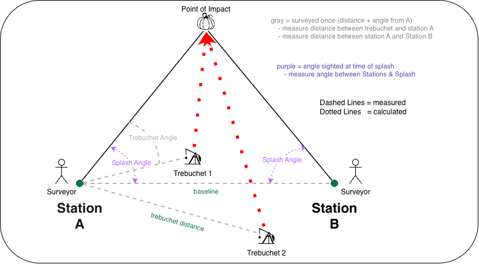

Two spotters sight the same landing point. The app finds where their sight lines cross, then measures the distance **from the selected trebuchet to the landing point**.

## Compass setup

1. **Place Stations A and B.** Both need a clear view of the landing area. Measure the distance between them: the **baseline**.
2. **Save reference bearings.** At A, sight B; at B, sight A. The readings should differ by 180°. Use the same compass at each station for its reference and shot readings.
3. **Survey each trebuchet.** Enter its distance and compass bearing from Station A.
4. **Log a shot.** Select the firing trebuchet and enter both spotters' bearings toward the same impact.

Spotters report bearings; the app does the math. For legacy angle events, enter angles measured from the line toward the other station instead.

## How much error should I expect?

**There is no fixed margin of error.** It depends on your readings and the station layout.

### Small angle errors matter

**Station spacing matters relative to the launch distance.** 

For a **200 ft launch distance** and a **1° error at B only**, the small-error estimates are:

| Station spacing (d) | Launch distance / spacing (R / d) | Distance error | Error ratio |
|---|---|---|---|
| 25 ft | 8:1 | ≈ 28.4 ft | ≈ 14.2% |
| 50 ft | 4:1 | ≈ 14.8 ft | ≈ 7.4% |
| 100 ft | 2:1 | ≈ 8.7 ft | ≈ 4.4% |
| 200 ft | 1:1 | ≈ 7.0 ft | ≈ 3.5% |

### Other factors

- **Geometry matters.** Distant targets and nearly parallel sight lines magnify errors. Wider station spacing can help.
- **Check your setup.** Keep compasses away from steel and vehicles. Repeatedly sight one fixed target to check consistency, and verify each trebuchet's survey.
- **GPS has uncertainty too.** The reported accuracy applies to each position fix; it is not a guaranteed error bound on the shot distance.

Use **Known actual distance** to compare a wheel or tape measurement with the result. Measure between the same launch and landing points; slopes or detours can make a wheel reading longer.

## Two formulas

For baseline length **d** and triangle angles **A** and **B**, the distance from Station A to impact is:

$$AP = d \cdot \frac{\sin(B)}{\sin(180^\circ - A - B)}$$

The app then accounts for the trebuchet's surveyed position. Compass bearings are converted to triangle angles automatically.

For a positive known distance, the displayed error is:

$$\text{error \%} = 100 \cdot \frac{|\text{calculated} - \text{known}|}{\text{known}}$$
